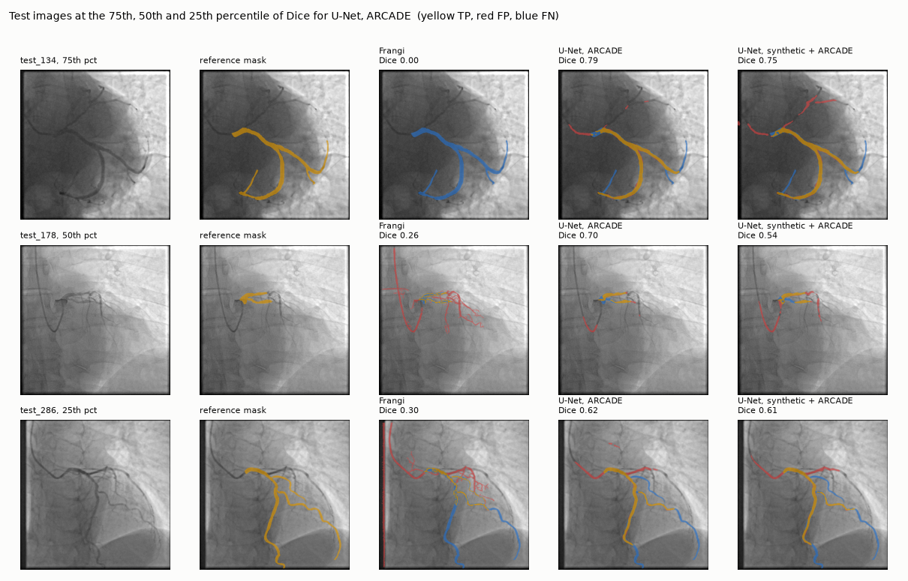
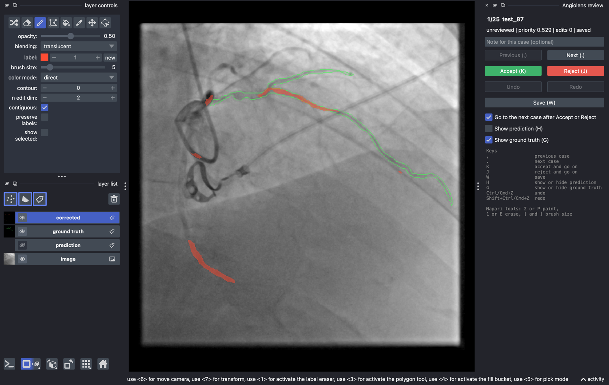

# Angiolens

Coronary vessel segmentation on X-ray angiograms, built end to end: dataset
download with checksums, data QA and a leakage-safe split, a synthetic
angiogram generator with exact masks, a classical Frangi baseline, a small
PyTorch U-Net, validation with bootstrap confidence intervals and failure
analysis, and a napari tool to review and correct predicted masks.

> Research and teaching demo. **Not for clinical use.**



## Results

Held-out ARCADE test split: 300 frames, never used for any choice. Mean over
frames with a 95% bootstrap confidence interval (10,000 resamples). The table
comes from `results/metrics/summary.json`; the source file of every other
number is listed in section 7 of the validation report.

| Method | Dice | clDice | Sensitivity | Precision |
|---|---|---|---|---|
| Frangi vesselness, validation-tuned threshold | 0.330 [0.310, 0.349] | 0.303 [0.284, 0.322] | 0.474 [0.445, 0.503] | 0.292 [0.273, 0.312] |
| U-Net, synthetic phantoms only | 0.297 [0.285, 0.309] | 0.270 [0.258, 0.281] | 0.494 [0.469, 0.519] | 0.235 [0.225, 0.246] |
| **U-Net, ARCADE (995 frames)** | **0.685 [0.669, 0.700]** | **0.664 [0.648, 0.680]** | 0.695 [0.677, 0.712] | 0.701 [0.684, 0.718] |
| U-Net, synthetic pretraining, then ARCADE | 0.683 [0.667, 0.698] | 0.665 [0.649, 0.680] | 0.696 [0.678, 0.712] | 0.694 [0.677, 0.711] |
| U-Net, 100 ARCADE frames | 0.658 [0.643, 0.673] | 0.635 [0.619, 0.651] | 0.666 [0.648, 0.683] | 0.678 [0.660, 0.695] |
| U-Net, synthetic pretraining, then 100 ARCADE frames | 0.664 [0.649, 0.678] | 0.642 [0.627, 0.658] | 0.670 [0.653, 0.686] | 0.683 [0.666, 0.701] |

What the numbers say:

* **The U-Net more than doubles the baseline.** Paired over the same 300
  frames it adds 0.355 Dice (95% CI 0.336 to 0.375, Wilcoxon p = 1.3e-50) and
  is better on 98% of frames. The tuned Frangi setting returns an empty mask
  on 13 frames.
* **Synthetic pretraining helps only when labels are scarce.** With 995
  labeled frames the difference is -0.002 Dice (CI -0.006 to 0.002, p = 0.32).
  With 100 labeled frames it adds 0.006 Dice (CI 0.001 to 0.010, p = 0.007)
  and 0.007 clDice (CI 0.002 to 0.013). Ten times more labels add 0.027 Dice
  (CI 0.022 to 0.033).
* **Errors are whole branches, not boundaries.** Only 13% of false positive
  pixels lie within 2 px of the reference mask and 24% of false negative
  pixels within 2 px of the prediction. The U-Net finds 91% of centerline
  pixels where the vessel radius is 6 px or more, but 23% where it is 2 to 3 px.
* **The labels define the task.** ARCADE annotates the named SYNTAX coronary
  segments, not every vessel. On 100 fresh synthetic phantoms with exact
  masks the ranking flips: the synthetic-only U-Net scores Dice 0.820, Frangi
  0.582 and the ARCADE U-Net 0.418, because the ARCADE model learned to leave
  small branches out.
* **Uncertainty points at failures.** Per-frame predictive uncertainty
  correlates with Dice (Spearman rho = -0.60). The 25 most uncertain test
  frames have mean Dice 0.515 against 0.685 overall and contain 6 of the 10
  worst frames; they form the review queue.
* **Speed.** 26.8 ms per 512 x 512 frame on the Apple M3 GPU (PyTorch MPS)
  against 187.0 ms on its CPU; Frangi vesselness takes 0.26 s per frame on
  CPU (`results/benchmark.json`, measured with other jobs running).

Details, the IoU column, paired tests and the failure review are in
[docs/validation_report.md](docs/validation_report.md).

## Pipeline

| Step | Command | What it does |
|---|---|---|
| Data | `make data` | Downloads ARCADE from Zenodo (451.6 MB), checks size, MD5 and SHA-256, extracts only the PNG and JSON files of the vessel task with a guarded extractor, rasterizes the polygons into binary masks. |
| QA and split | `make split` | Pairing, sizes, modes, empty and non-binary masks, exact duplicates (SHA-256) and near duplicates (thumbnail correlation), intensity and vessel caliber statistics; then the official split with a leakage guard. |
| Simulated data | `make synth` | 1,200 training and 100 validation phantoms: branching vessel trees, Beer-Lambert attenuation, background anatomy, an unlabeled catheter, blur and noise, exact masks. |
| Baseline | `make baseline` | Multiscale Frangi vesselness (scikit-image); threshold rule, cutoff and minimum component size picked on validation only. |
| Training | `make train` | Five U-Net runs from TOML configs in `configs/`: ARCADE from scratch, synthetic only, synthetic then ARCADE, and both again with 100 ARCADE frames. |
| Prediction | `make predict` | Probability threshold tuned on validation per run, then test masks and probability maps. |
| Validation | `make evaluate` | Dice, IoU, sensitivity, precision and clDice per frame, bootstrap CIs, paired tests, caliber analysis, failure overlays, uncertainty ranking, phantom check. |
| Review | `make review` | Opens the napari review tool on the uncertainty-ranked queue. |
| Speed | `make benchmark` | Inference latency on the Apple GPU and the CPU. |
| Tests | `make test` | 123 unit tests (metrics, statistics, generator, QA, split, download safety, model, review logic and GUI). |

## Run it

Requirements: macOS or Linux, [uv](https://docs.astral.sh/uv/), and about
2.2 GB of disk for data and caches plus the Python environment. The device is
picked automatically: Apple GPU (MPS), then CUDA, then CPU.

```bash
make setup        # Python 3.12 venv in .venv with pinned packages
                  # (use make setup UV=~/.local/bin/uv if uv is not on PATH)
make all          # every step above except the review tool, in order
make review       # review tool on the queue made by make evaluate
make review-demo  # review tool on six synthetic cases, no download needed
```

Measured run times on an Apple M3 with 8 GB of memory, while other jobs were
running: the training runs took 14.2 (ARCADE from scratch), 5.0 (synthetic
only), 14.8 (synthetic then ARCADE), 6.2 and 6.0 minutes (the two 100-frame
runs) according to `results/train_logs/`; the Frangi validation search took
6.7 minutes and the evaluation 1.6 minutes. Each run has a time guard in its
config.

## Review tool



```bash
.venv/bin/python -m angiolens.review.napari_app --manifest results/review_queue.csv --reviewer kp
```

The tool opens one case at a time. The editable `corrected` layer starts
from the model mask; napari's brush and eraser edit it, and every finished stroke is
recorded by the session, which owns undo and redo. Accept, reject, previous,
next and save are buttons and keys (`K`, `J`, `,`, `.`, `W`). Each saved case
writes `masks/<id>.png` and one row in `review_log.csv`: status, note,
reviewer, pixels added and removed, Dice against the original prediction and
a UTC timestamp. The logic lives in `src/angiolens/review/session.py` with no
GUI imports, so it is covered by unit tests; the GUI test builds a hidden
viewer and drives a stroke through napari.

## Data

* **ARCADE** (syntax subset), Zenodo record
  [10390295](https://zenodo.org/records/10390295), license CC0 1.0. Cite:
  Popov M, Amanturdieva A, Zhaksylyk N, et al. Dataset for Automatic
  Region-based Coronary Artery Disease Diagnostics Using X-Ray Angiography
  Images. *Scientific Data* 11, 20 (2024). doi:10.1038/s41597-023-02871-z.
  1,500 frames (512 x 512) with polygons for 25 SYNTAX coronary segments.
  After QA: 995 train, 198 validation, 300 test frames.
* **Synthetic phantoms** from `src/angiolens/synth/generator.py`, seeded and
  regenerated on demand. They are digital phantoms, not images of a
  physical phantom.

The data never enter the repository (`data/` is gitignored). Figures in
`results/` show a few ARCADE frames, which CC0 allows. See
[docs/data_card.md](docs/data_card.md) for checksums, QA results and the split.

## Layout

```
configs/                 TOML configs for every training run
src/angiolens/data/      download, mask rasterization, QA, split, training dataset
src/angiolens/synth/     synthetic angiogram generator and dataset builder
src/angiolens/baseline/  Frangi baseline
src/angiolens/models/    U-Net and device selection
src/angiolens/eval/      metrics, bootstrap statistics, evaluation, plots
src/angiolens/review/    review session logic and the napari app
src/angiolens/train.py, predict.py, benchmark.py
tests/                   unit tests
docs/                    data card, model card, validation report, reproducibility notes
results/                 metrics, logs, figures, failure overlays (all from real runs)
```

## Limitations

* The reference masks cover the annotated SYNTAX segments, not every visible
  vessel, so "vessel segmentation" here means reproducing that protocol.
* ARCADE has no patient identifiers. The split removes duplicate and
  near-duplicate frames across splits but cannot guarantee that one patient
  sits in one split only.
* One dataset and no external test set: the DCA1 host timed out when this was
  built. Results may not transfer to other sites or scanners.
* Single 2D frames; the time dimension of an angiography run is not used.
* Training runs were capped at about 14 minutes on a laptop GPU, and two
  runs stopped on that cap (3,348 and 3,100 steps); larger models and longer
  training were not explored.
* MPS training is not bitwise deterministic; evaluation of saved checkpoints is.
* The CUDA path is implemented but was not run (no NVIDIA GPU). TensorFlow
  was not used.

## License

Code: MIT (see [LICENSE](LICENSE)). Data: ARCADE is CC0 1.0; please cite the
dataset paper above.
