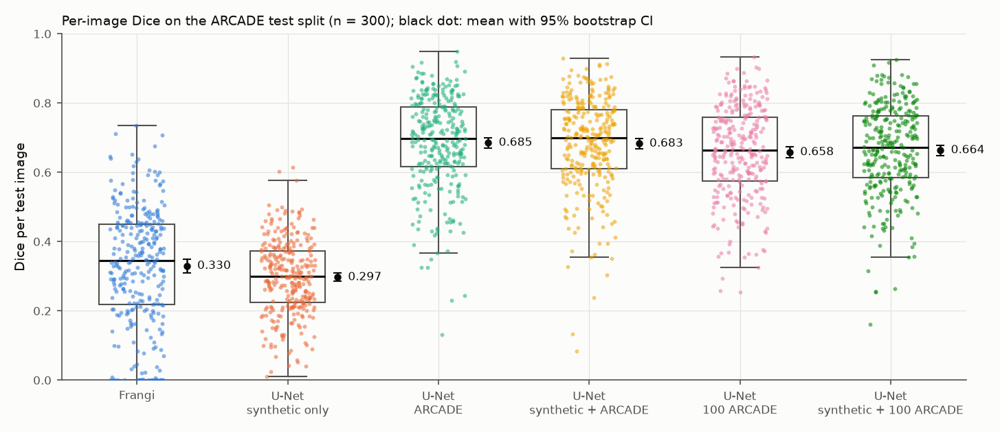
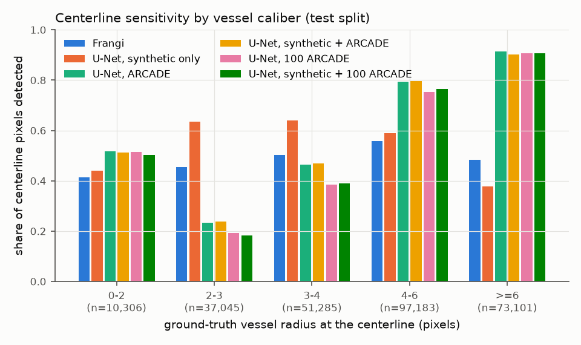
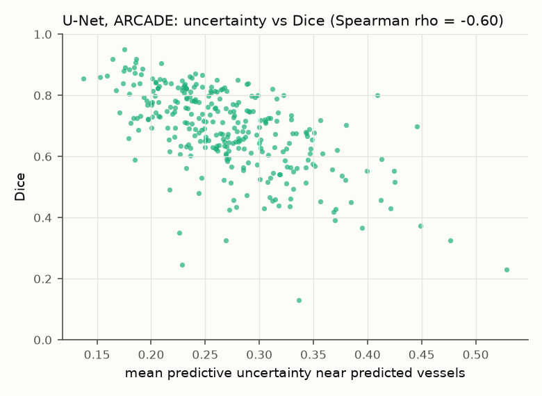

# Validation report

All numbers below come from files in `results/` written by the commands named
in each section. Nothing was typed in by hand.

## 1. Question and scope

How well do a classical vesselness filter and a small U-Net reproduce expert
coronary segment masks on X-ray angiography frames, how much does synthetic
pretraining help, and where do the models fail? Intended use is research and
teaching (see `docs/model_card.md`); this is not a clinical validation.

## 2. Data

ARCADE syntax subset (CC0, details in `docs/data_card.md`). After QA and the
leakage guard: 995 training, 198 validation and 300 test frames, all
512 x 512. The reference mask of a frame is the union of its annotated SYNTAX
segment polygons. The test split is the official one and was used once, after
every choice below was frozen.

## 3. Methods

### 3.1 Frangi baseline (`src/angiolens/baseline/frangi.py`)

Per-frame robust intensity window, `skimage.filters.frangi` with dark ridges
and sigma 1, 1.5, 2, 3, 4, 5 and 6 px, response zeroed within 8 px of black
collimator borders. Three threshold rules (fraction of the frame maximum,
top fraction of pixels, hysteresis) and nine minimum component sizes (0 to
4,000 px) were searched on validation, 324 settings in all
(`results/frangi_tuning.json`).

Selected: hysteresis with a high cutoff of 0.02643 times the frame maximum and
a low cutoff of a quarter of that, then removal of components of at most
1,500 px. Mean validation Dice 0.387. The selected values are inside the
searched ranges, not at an edge.

### 3.2 U-Net (`src/angiolens/models/unet.py`, `src/angiolens/train.py`)

2D U-Net with 4 pooling stages and 16 base channels (1,963,809 weights),
trained on random 256 x 256 crops with flips and intensity augmentation,
BCE plus soft Dice loss, AdamW (learning rate 1e-3, weight decay 1e-4), 200
warm-up steps then cosine decay, batch size 8, seed 42, Apple M3 GPU (MPS).
The checkpoint with the best validation Dice (threshold 0.5) is kept; the
probability threshold is then tuned on validation over 0.10 to 0.90.

| Run (config) | Training data | Epochs | Steps | Minutes | Best epoch | Threshold (val Dice) |
|---|---|---|---|---|---|---|
| unet_scratch | 995 ARCADE | 27 | 3,348 | 14.2 | 22 | 0.65 (0.741) |
| unet_synth_only | 1,200 phantoms | 8 | 1,200 | 5.0 | 8 | 0.45 (0.832, synthetic val) |
| unet_synth_finetune | 995 ARCADE, starts from unet_synth_only | 25 | 3,100 | 14.8 | 25 | 0.65 (0.735) |
| unet_scratch_n100 | 100 ARCADE (seeded subset) | 100 | 1,200 | 6.2 | 100 | 0.75 (0.713) |
| unet_synth_finetune_n100 | the same 100, starts from unet_synth_only | 100 | 1,200 | 6.0 | 100 | 0.75 (0.711) |

Sources: `results/train_logs/<run>.json` and `results/thresholds/<run>.json`.
The two full-data runs stopped on their 14-minute guard; the fine-tuning run
got 248 fewer steps than the scratch run because the machine was busier. The
synthetic-only model never saw an ARCADE label: its checkpoint and threshold
were chosen on synthetic validation phantoms.

## 4. Metrics and statistics (`src/angiolens/eval/`)

Per test frame, with P the predicted mask and G the reference:

* Dice = 2 TP / (2 TP + FP + FN); IoU = TP / (TP + FP + FN)
* Sensitivity = TP / (TP + FN); Precision = TP / (TP + FP)
* clDice (Shit et al., CVPR 2021) = harmonic mean of topology precision
  |skel(P) and G| / |skel(P)| and topology sensitivity |skel(G) and P| / |skel(G)|,
  skeletons from `skimage.morphology.skeletonize`. It rewards following the
  centerline and is insensitive to vessel width.
* Conventions: both masks empty gives 1.0; otherwise a zero denominator gives
  0.0. These cases are unit tested (`tests/test_metrics.py`).

Aggregation is the mean over the 300 frames. Confidence intervals are 95%
percentile bootstrap intervals over frames (10,000 resamples, fixed seed).
Method comparisons are paired: the bootstrap interval of the mean per-frame
difference plus a two-sided Wilcoxon signed-rank test (SciPy).

## 5. Results

### 5.1 Test metrics (`results/metrics/summary.md`)

| Method | Dice | IoU | Sensitivity | Precision | clDice |
|---|---|---|---|---|---|
| Frangi | 0.330 [0.310, 0.349] | 0.210 [0.196, 0.224] | 0.474 [0.445, 0.503] | 0.292 [0.273, 0.312] | 0.303 [0.284, 0.322] |
| U-Net, synthetic only | 0.297 [0.285, 0.309] | 0.179 [0.171, 0.188] | 0.494 [0.469, 0.519] | 0.235 [0.225, 0.246] | 0.270 [0.258, 0.281] |
| U-Net, ARCADE | 0.685 [0.669, 0.700] | 0.536 [0.519, 0.553] | 0.695 [0.677, 0.712] | 0.701 [0.684, 0.718] | 0.664 [0.648, 0.680] |
| U-Net, synthetic + ARCADE | 0.683 [0.667, 0.698] | 0.533 [0.516, 0.549] | 0.696 [0.678, 0.712] | 0.694 [0.677, 0.711] | 0.665 [0.649, 0.680] |
| U-Net, 100 ARCADE | 0.658 [0.643, 0.673] | 0.505 [0.488, 0.521] | 0.666 [0.648, 0.683] | 0.678 [0.660, 0.695] | 0.635 [0.619, 0.651] |
| U-Net, synthetic + 100 ARCADE | 0.664 [0.649, 0.678] | 0.510 [0.494, 0.527] | 0.670 [0.653, 0.686] | 0.683 [0.666, 0.701] | 0.642 [0.627, 0.658] |

Median Dice: Frangi 0.346, synthetic only 0.299, ARCADE 0.698, synthetic +
ARCADE 0.699, 100 ARCADE 0.665, synthetic + 100 ARCADE 0.671. The tuned
Frangi setting produced an empty mask on 13 of 300 frames; no U-Net did.

### 5.2 Paired comparisons (`results/metrics/comparisons.json`)

| Comparison | Metric | Mean difference [95% CI] | Wilcoxon p | Frames where the first is better |
|---|---|---|---|---|
| U-Net ARCADE vs Frangi | Dice | 0.355 [0.336, 0.375] | 1.3e-50 | 98% |
| U-Net ARCADE vs Frangi | clDice | 0.361 [0.341, 0.382] | 2.5e-50 | 97% |
| Synthetic + ARCADE vs ARCADE | Dice | -0.002 [-0.006, 0.002] | 0.32 | 48% |
| Synthetic + ARCADE vs ARCADE | clDice | 0.000 [-0.005, 0.005] | 0.56 | 53% |
| Synthetic + 100 vs 100 ARCADE | Dice | 0.006 [0.001, 0.010] | 0.0067 | 55% |
| Synthetic + 100 vs 100 ARCADE | clDice | 0.007 [0.002, 0.013] | 0.012 | 54% |
| ARCADE (995) vs 100 ARCADE | Dice | 0.027 [0.022, 0.033] | 1.3e-21 | 77% |
| U-Net ARCADE vs synthetic only | Dice | 0.388 [0.375, 0.402] | 6.1e-51 | 99.7% (299 of 300) |

Reading: the learned model is far ahead of the filter on every frame type.
Synthetic pretraining makes no measurable difference with the full training
set and a small, statistically clear but practically modest difference
(about half a Dice point) with 100 frames. Going from 100 to 995 labeled
frames is worth about 2.7 Dice points.

### 5.3 Where the errors are (`results/metrics/failure_analysis.json`)

The primary model for this analysis is the full-data U-Net with the higher
validation Dice, which is the scratch model (0.741 against 0.735).

* Dice quartiles 0.616, 0.698 and 0.789; 29 of 300 frames are below 0.5.
* Only 13% of false positive pixels lie within 2 px of the reference mask and
  24% of false negative pixels within 2 px of the predicted mask. Most error
  pixels belong to whole branches that were added or missed, not to
  disagreement about vessel width.
* Spearman correlation of per-frame Dice with frame properties: intensity
  standard deviation -0.33 (p = 7.3e-9), vessel fraction 0.17 (p = 0.0026),
  mean intensity -0.08 (p = 0.15), number of annotated segments 0.08
  (p = 0.19), black border fraction 0.04 (p = 0.46). Busy, high contrast
  backgrounds and frames with little annotated vessel are harder.

Centerline sensitivity by vessel caliber (`results/metrics/sensitivity_by_radius.json`):
the share of reference skeleton pixels covered by the prediction, binned by
the distance transform radius at each skeleton pixel.

| Radius (px) | 0 to 2 | 2 to 3 | 3 to 4 | 4 to 6 | 6 or more |
|---|---|---|---|---|---|
| Skeleton pixels | 10,306 | 37,045 | 51,285 | 97,183 | 73,101 |
| Frangi | 0.413 | 0.455 | 0.502 | 0.557 | 0.483 |
| U-Net, synthetic only | 0.440 | 0.634 | 0.640 | 0.590 | 0.377 |
| U-Net, ARCADE | 0.518 | 0.233 | 0.464 | 0.793 | 0.913 |
| U-Net, synthetic + ARCADE | 0.513 | 0.239 | 0.469 | 0.795 | 0.903 |
| U-Net, 100 ARCADE | 0.516 | 0.191 | 0.386 | 0.753 | 0.906 |
| U-Net, synthetic + 100 ARCADE | 0.502 | 0.184 | 0.389 | 0.766 | 0.906 |

The ARCADE-trained models find large vessels reliably and thin annotated
segments poorly. The synthetic-only model is the opposite: its phantoms label
every vessel, so it marks thin vessels readily and misses wide ones. The 0 to
2 px bin mixes the tips of thin vessels with short skeleton spurs near the
edges of wide vessels, so it should not be read on its own.

### 5.4 Failure review (`results/failures/`)

Visual review of the six lowest-Dice test frames for the primary model
(`results/failures/worst_cases.png`; yellow true positive, red false
positive, blue false negative):

| Frame | Dice | What the overlay shows |
|---|---|---|
| test_142 | 0.131 | A side branch is segmented while the long annotated vessel, faint in its upper part, is mostly missed. |
| test_87 | 0.229 | Low contrast with looped catheters in view; most of the annotated vessel is missed and an unannotated branch is marked. |
| test_146 | 0.245 | The catheter and a long vessel outside the annotated proximal segment are segmented (sensitivity 0.81, precision 0.14). |
| test_258 | 0.325 | A wide vessel along the left edge is missed while thinner branches are partly found. |
| test_211 | 0.325 | Several unannotated branches are segmented next to the one annotated path. |
| test_28 | 0.350 | The catheter is segmented as a vessel and part of the annotated vessel is missed. |

Three failure types repeat: (1) catheters taken for vessels, (2) visible
vessels that the annotators did not include, which are protocol
disagreements rather than detection errors, and (3) faint or very wide
annotated vessels that are missed.

### 5.5 Uncertainty as a review signal (`results/metrics/uncertainty.json`)

Per-frame uncertainty is the mean of 4p(1 - p) over pixels near predicted
vessels (p at least 0.1, or within 3 px of p at least 0.5). Spearman
correlation with Dice: -0.60 for the scratch model (p = 2.5e-31), -0.56,
-0.55 and -0.53 for the other ARCADE-trained runs and -0.28 for the
synthetic-only model. The 25 most uncertain test frames of the primary model
have mean Dice 0.515 against 0.685 for all frames and include 6 of the 10
lowest-Dice frames. They are written to `results/review_queue.csv`, which the
review tool opens first. The threshold of 25 frames is a review budget, not a
tuned value.

### 5.6 Phantom check (`results/metrics/synthetic_check.json`)

100 new phantoms (seeds 3,000,000 to 3,000,099, never used for training or
selection), exact masks, each method with its frozen settings:

| Method | Dice | Sensitivity | Precision | clDice |
|---|---|---|---|---|
| Frangi | 0.582 | 0.884 | 0.502 | 0.567 |
| U-Net, synthetic only | 0.820 | 0.860 | 0.813 | 0.813 |
| U-Net, ARCADE | 0.418 | 0.344 | 0.744 | 0.337 |
| U-Net, synthetic + ARCADE | 0.328 | 0.259 | 0.709 | 0.274 |

The ranking is the reverse of the ARCADE ranking. Two lessons: what a model
learns is set by the labeling protocol as much as by the images, and
fine-tuning on ARCADE removed most of the phantom skill (0.820 to 0.328 for
the same initial weights). The phantom check also exercises the metric and
baseline code on data whose truth is known exactly.

### 5.7 Speed (`results/benchmark.json`)

One 512 x 512 frame, batch size 1, median of 50 timed passes after 10
warm-up passes: U-Net 26.8 ms on the Apple M3 GPU (MPS) and 187.0 ms on the
CPU (4 threads). Frangi vesselness: median 0.26 s per frame on the CPU over
20 test frames. Other programs were running, so these are indicative.

## 6. Threats to validity

* **Label protocol.** References cover SYNTAX segments only. Some false
  positives are real vessels; scores measure agreement with this protocol.
* **Reference noise.** Five frames appear twice in the training set with two
  different masks; the two masks agree with Dice 0.744 to 0.936
  (`results/data_qa.json`). Test scores near that range are close to the
  agreement between labelings of the same frame.
* **Leakage.** No patient identifiers. Near-identical frames are kept in one
  split, but other frames of the same patient may still be split apart.
* **Single dataset.** No external test set (DCA1 was unreachable). No claim is
  made about other sites, scanners or protocols.
* **Compute limits.** Short, time-capped training on a laptop GPU and one seed
  per configuration. The differences between U-Net variants (a few
  thousandths to a few hundredths of Dice) are within what a different seed
  could change; only the U-Net against Frangi gap is large relative to that.
* **Threshold search on validation.** The validation split guided several
  choices, so validation scores are optimistic; only test scores are reported
  as results.

## 7. Traceability

| Claim | File |
|---|---|
| Test metrics and CIs | results/metrics/summary.json, summary.md, per_image_<method>.csv |
| Paired comparisons | results/metrics/comparisons.json |
| Caliber analysis | results/metrics/sensitivity_by_radius.json |
| Error composition and correlations | results/metrics/failure_analysis.json |
| Uncertainty and review queue | results/metrics/uncertainty.json, results/review_queue.csv |
| Phantom check | results/metrics/synthetic_check.json |
| Frangi tuning | results/frangi_tuning.json |
| Training runs | results/train_logs/ |
| Thresholds | results/thresholds/ |
| Speed | results/benchmark.json |
| Data QA and split | results/data_qa.md, data_qa.json, splits.csv, split_summary.json |
